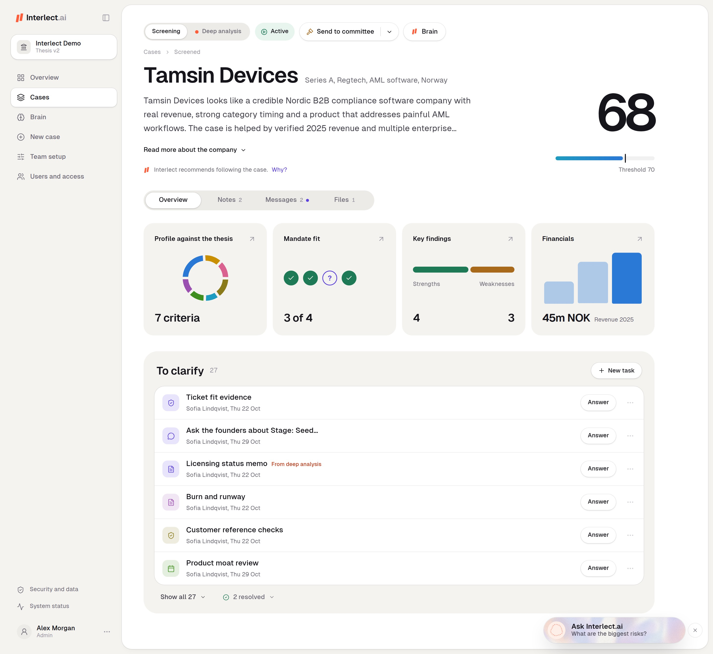
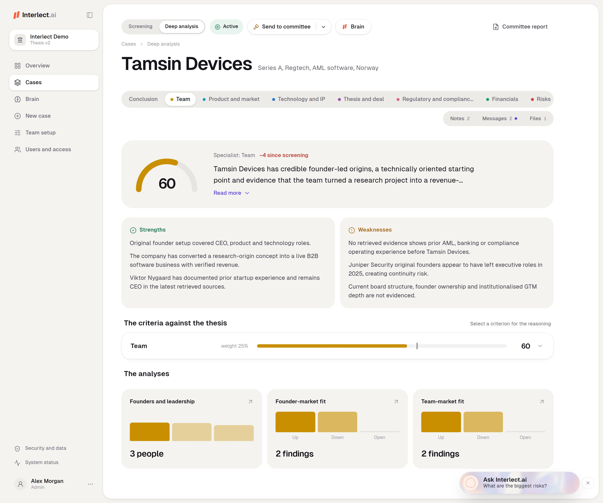
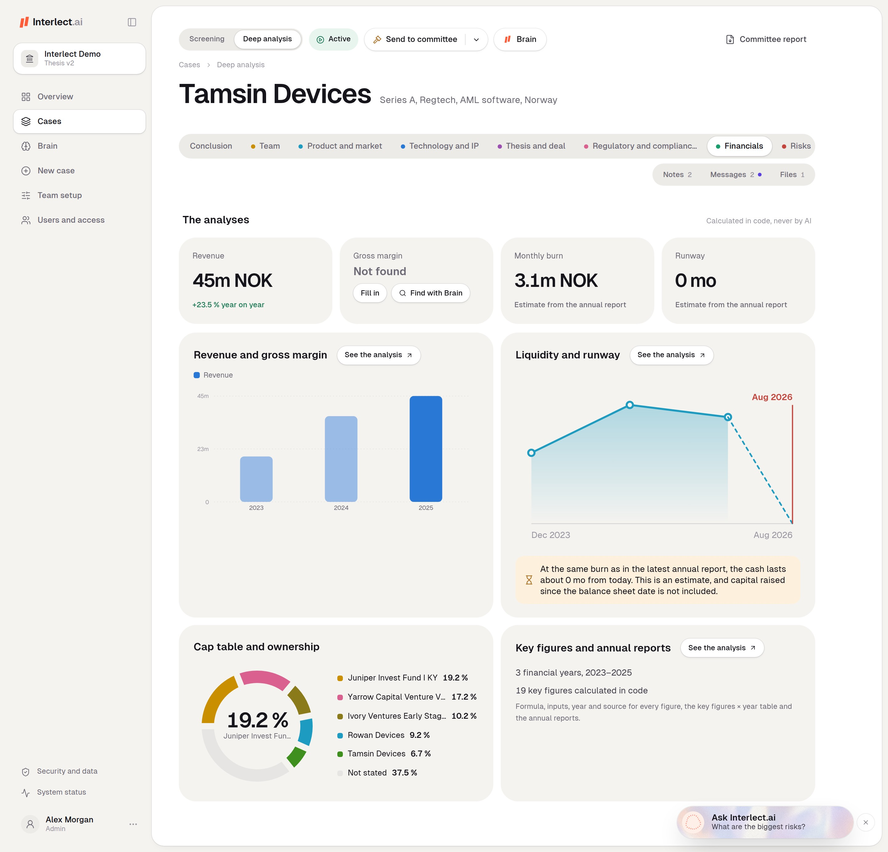
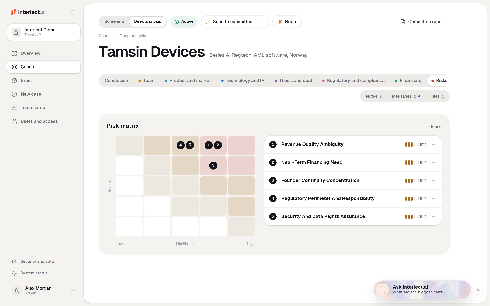

<div align="center">

# Interlect

**AI analyst for investment teams: screening against your thesis, deep analysis by specialists, and Brain, the team's knowledge layer.**

*Less time on decks. More time with founders.*

[interlect.ai](https://interlect.ai) · [Set it up on your own accounts](SETUP.md) · [Apache-2.0](LICENSE)

</div>

---

## What it is, in one minute

More opportunities reach an investment team than anyone has time to look at properly. Most get a few
minutes. The hours go into pulling facts out of decks and registries, two people judge the same case
differently, and when someone leaves, what the team learned leaves with them.

Interlect takes the groundwork off the team. You describe your thesis once: your criteria, your
weights, your deal-breakers. From then on, every case that comes in gets a proper first look, and
every case that deserves it gets a full analysis, in minutes. **The decision always stays with your
people.** Interlect recommends and shows its evidence; it never decides.



## What it does

**1. Screens every case against your thesis.**
It reads the pitch deck, looks the company up in the official registers, researches the web and
scores the case on your criteria, the same way every time. Every score shows the facts it rests on
and where each fact came from. Figures from the deck are marked as self-reported. A fact that
can't be sourced is left out or flagged as still to be confirmed, never stated as true.

**2. Sends in a team of specialists when a case deserves depth.**
Four specialists (team, market, technology, deal) go deep on their part side by side, plus up to
three specialists you define yourself. One synthesis weighs it all against your thesis and prepares
the committee: score, risks, open questions. A quality check rejects any answer that skips a
criterion or cites a source the research never found.



**3. Remembers everything: Brain.**
Every case, note and decision, with the reason in your own words, becomes part of your team's
memory. Ask it like a colleague: *"Why did we pass on that company?"*, *"What do the cases we moved
forward with have in common?"* Brain plans its search, reads the cases, compares with your earlier
decisions and answers with sources you can click. It knows **what was true when**, because every
fact keeps its dates in a temporal knowledge graph.

**4. Learns from your decisions, under your control.**
After each decision Brain reflects on why, and can suggest a lesson in plain words. A lesson only
becomes active when your own cases back it up. No AI ever rewrites a lesson. Every night Brain
tidies its memory, and before every release it has to pass an exam against an approved earlier
version, so it never quietly gets worse.



## Built to be trusted in a real decision

| | |
|---|---|
| **AI reads and reasons. Code does the math.** | Weights times scores, totals, burn and runway are calculated in code, the same way for every case. No invented numbers. |
| **Sources, checked in code** | Every criterion rests on cited evidence, and the citations are verified before a result is accepted. |
| **Official registers, not guesses** | Company details and filed annual accounts from the registers of Denmark, Sweden, Norway, Finland, Estonia, Latvia, Lithuania, Poland, the Netherlands and France, plus GLEIF. |
| **Your data stays yours** | It runs on your own Supabase (EU region) and your own Vercel account. AI calls go through the Vercel AI Gateway with zero data retention and EU inference where offered. |
| **Strict separation** | Every row is scoped to your fund with row-level security in Postgres, enforced in the database and tested. |
| **Honest about itself** | Brain tells you it is an AI, answers from your own material, and the web only when you ask. |



## Who it is for

Any team that screens opportunities against a thesis and wants a proper first look at every one:
venture and growth investors, angel groups, family offices, corporate venture teams, accelerators.
The thesis, the criteria and the specialists are yours to define, in English or Danish.

## Under the hood

- **App:** [TanStack Start](https://tanstack.com/start) (React 19, Vite, Nitro), TypeScript throughout
- **Data:** [Supabase](https://supabase.com): Postgres 17, sign-in (with MFA), private file storage, row-level security
- **Runtime:** [Vercel](https://vercel.com): Functions, Queues for the long analysis jobs, Cron for Brain's nightly work, AI Gateway
- **AI:** multi-agent analysis, agentic retrieval over a temporal knowledge graph, learning from decisions, evaluated before every release
- **Quality:** a typed, linted code base with unit tests and database tests (including row-level-security proofs), checked on every change in CI

## Install on your own accounts

You need **Node.js 24**, **git**, a free **Supabase** account and a **Vercel** account. Then:

```bash
git clone https://github.com/Interlect-ai/interlect.git
cd interlect
npm ci
npm run setup
```

`npm run setup` does everything: it creates the database in the EU, runs the migrations, creates
your fund and an admin account, deploys the app to Vercel, checks that it is healthy and gives you
a one-time link to sign in. It then offers ten fictional demo cases, so every screen has content
from the first minute; one click removes them again.

**New to this? Follow the step-by-step guide: [SETUP.md](SETUP.md).** It explains every step in
plain language, what it costs, which Vercel plan a team needs, and what to do if something stops.
The technical reference is [docs/selfhost/README.md](docs/selfhost/README.md), and every
environment variable is listed in [.env.example](.env.example).

## Develop

```bash
npm run dev          # local dev server (needs .env.local; npm run setup can write it)
npm run build        # production build
npx eslint src       # lint
npm test             # unit tests
npm run db:local     # local Postgres for the database tests
npm run seed:demo    # the ten fictional demo cases (no AI calls)
```

See [CONTRIBUTING.md](CONTRIBUTING.md) and [SECURITY.md](SECURITY.md).

## License

Apache License 2.0; see [LICENSE](LICENSE) and [NOTICE](NOTICE).
